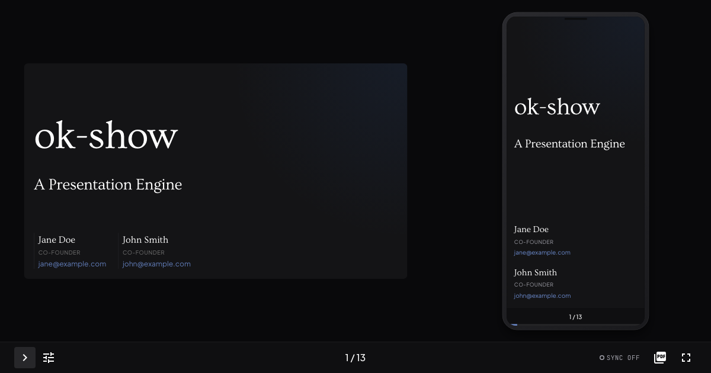
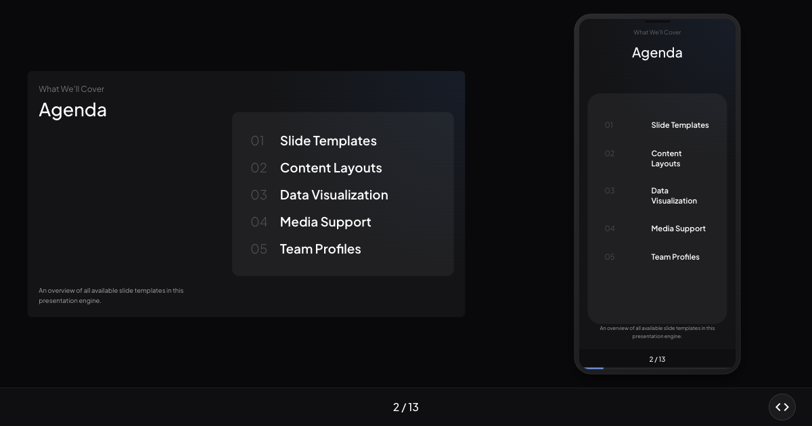
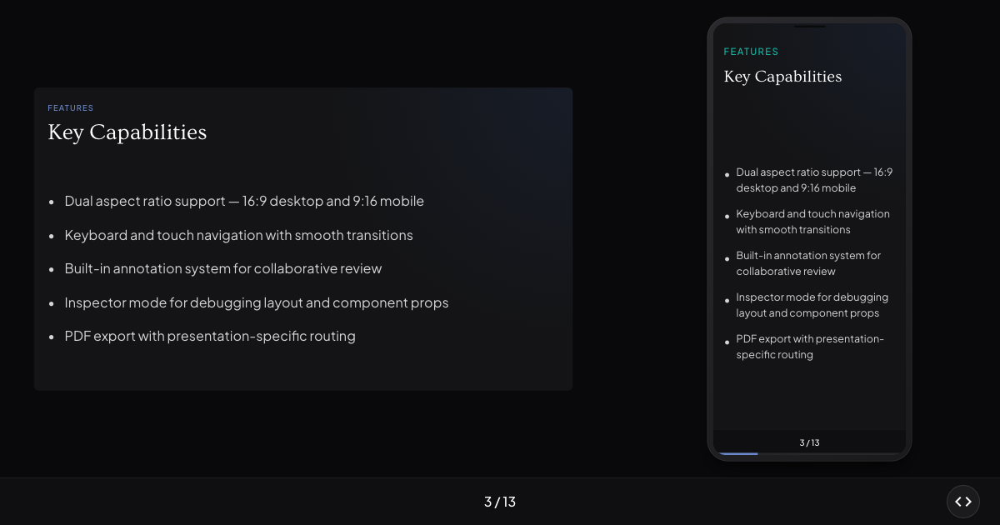
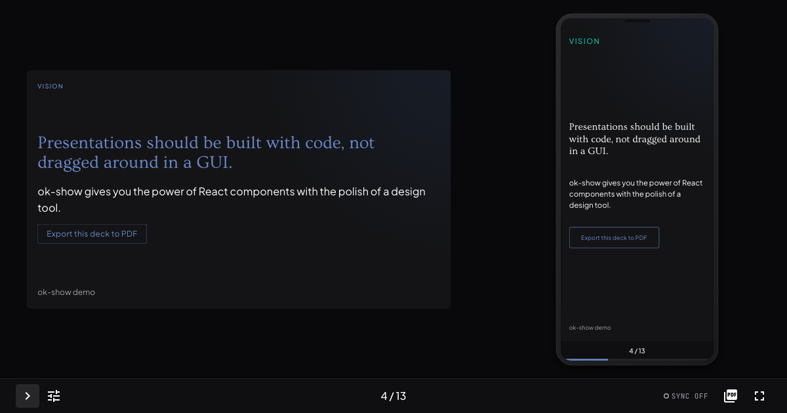
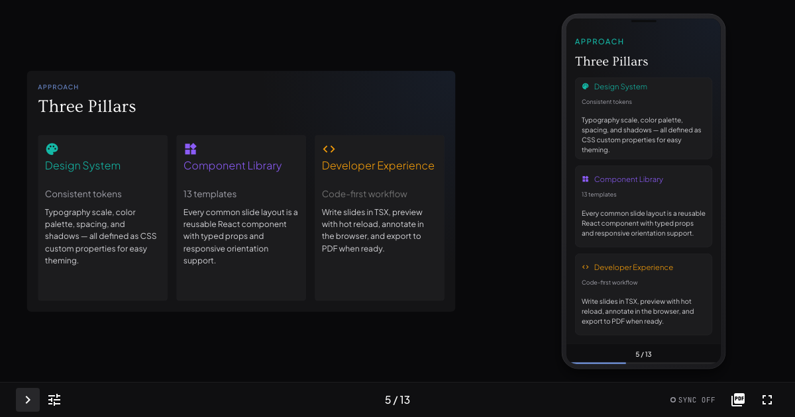
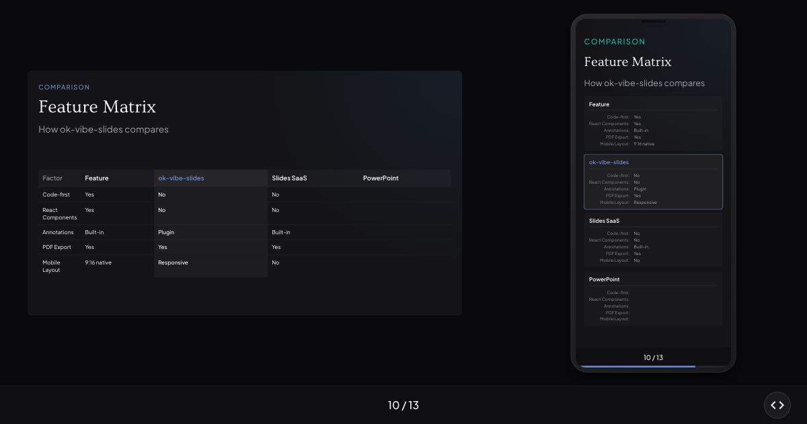
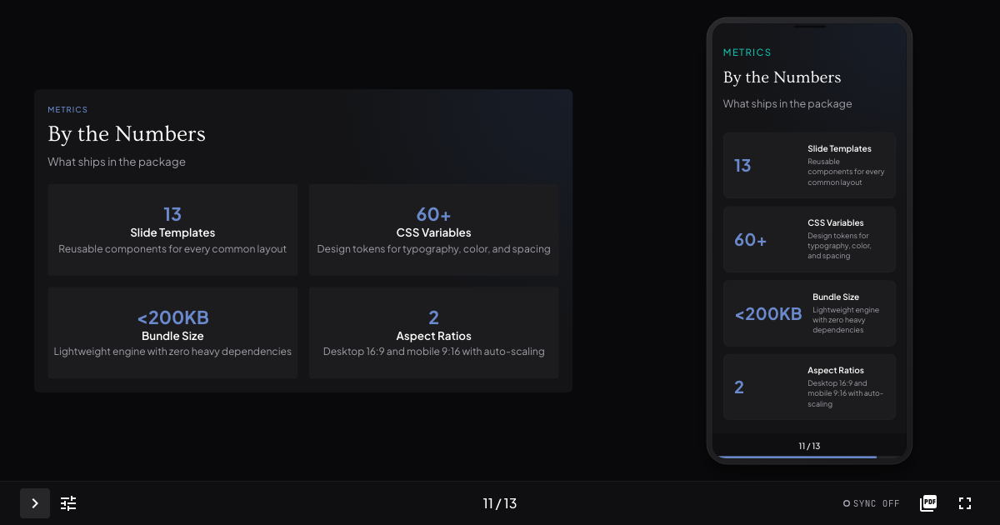
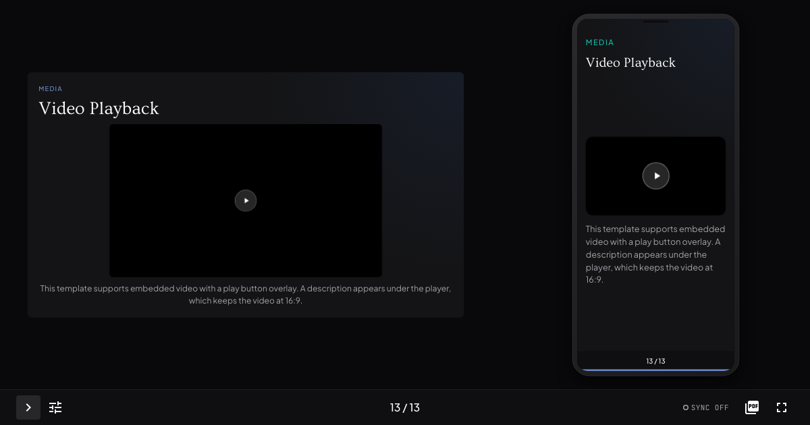

# ok-show

Slides you write in code and polish with an AI agent.

Each slide is a small React component. You get a set of ready-made layouts
(title, bullets, big numbers, team, video, and more), a browser preview that
shows the desktop and phone versions, and a way to point at anything on a slide
and leave a note like "make this smaller" or "swap these two". When you're done
leaving notes, one button copies all of them in a format your coding agent
(Claude Code, Cursor, Codex, whatever you use) can act on straight away.

It also has the things you need on the day itself: speaker notes on your
phone, a rehearsal mode that walks through your script, PDF export, and a
public build you can host anywhere.



[Watch a 30-second tour](docs/assets/ok-show-demo.mp4) of themes and
the synced presenter view.

## How a session goes

1. **Ask your agent for a deck.** "Make me a 10-minute talk about our Q3
   launch for the sales team." It writes the slides in your project.
2. **Look at it in the browser.** `npm run dev` gives you a live preview that
   updates as files change.
3. **Point at what's wrong.** Hold **Alt** and click any part of a slide, then
   type what you want: "this title wraps badly", "use a photo here", "move this
   slide before the pricing one".
4. **Hand the notes to your agent.** Click **Copy All** and paste into your
   agent. It gets the exact slide, the exact element, the source file to edit,
   and your comment.
5. **Repeat** until you like it.

You can do all of it without writing any CSS yourself. You can also edit the
code by hand whenever you want, since it's just files in your project.

## Before you start

You'll need:

- **Node.js 20.19 or newer.** Check with `node -v`.
- **Access to the GitHub repo.** ok-show installs straight from
  GitHub, and the repo is private, so whatever lets you run
  `git clone git@github.com:okthink-ai/ok-show.git` is what lets you
  install it. If that clone fails, ask whoever shared this with you to add you.
- **A browser.** Chrome is best, since the debug tools drive it.
- **A coding agent**, if you want the agent workflow. It's optional; the deck
  works fine without one.

## Make your first deck

```bash
npx github:okthink-ai/ok-show init my-talk --title "My Talk" --install
cd my-talk
npm run dev
```

That creates a `my-talk` folder with a starter deck in it, installs
everything, and starts the dev server. When it's running you'll see
something like this in the terminal:

```text
  Open these links; each carries this run's control token (also in
  .tmp/sync-control-token). Anyone with the token can drive the deck.
    Deck       http://localhost:5199/?session=default&token=3f9c...
    Presenter  http://localhost:5199/notes?session=default&token=3f9c...
    Presenter  http://192.168.1.20:5199/notes?session=default&token=3f9c...
```

**Open the Deck link from the terminal** (don't just type
`localhost:5199`). That long `token` is what connects the deck to your speaker
notes and the presenter remote. The page tucks it away and cleans up the
address bar, so you only need to do this once per tab. If you open the plain
address, the slides still work but notes show as disconnected.

The starter deck has one slide for every built-in layout, with sample text.
Click around, then start replacing it with your own content (or ask your agent
to).

A few keys to know right away:

| Key | What it does |
|-----|--------------|
| **←** / **→** | Previous / next slide |
| **F** | Fullscreen |
| Hold **Alt** | Inspector: hover to see what an element is, click to leave a note |

The footer at the bottom of the page has the rest: the developer tools drawer,
the phone preview, the text style tweaker, PDF export, and fullscreen.

## What's in your project

`init` copies the things you'll actually edit into your project. The app
itself, the presenter view, and the dev tools stay inside the
`ok-show` package in `node_modules`, so you never have to look at them.

| Path | What it's for |
|------|---------------|
| `src/data/presentations/my-talk/slides.tsx` | Your slides |
| `src/data/presentations/my-talk/index.ts` | Deck title, description, and date |
| `src/data/presentations/my-talk/notes.mjs` | Speaker notes (private, never published) |
| `src/data/presentations/my-talk/manuscript.md` | Your full script, for Practice mode |
| `src/data/presentations/my-talk/sparkle.mjs` | Image prompts for Sparkle (optional) |
| `src/data/presentations/index.ts` | The list of decks in this project |
| `src/components/slides/` | The slide layouts. These are your copies, so change them freely |
| `src/styles/brand.css` | Your colors and fonts |
| `public/` | Images, video, favicon |
| `ok-show.config.ts` | Page title, extra `<head>` tags, folder locations |
| `AGENTS.md` | Instructions for your coding agent |
| `README.md` | A short guide to the project |

The deck folder is named after your project folder (`my-talk` here). Use
`--deck` to pick a different name.

**Using Claude Code?** It reads `CLAUDE.md`, not `AGENTS.md`. Create a
`CLAUDE.md` with this one line so it picks up the same instructions:

```text
@AGENTS.md
```

## Writing slides

A deck is a list of slides. Each slide has a stable `id`, a `title` (used in
the outline, not shown on the slide), the name of its layout in `template`, and
the layout itself in `content`:

```tsx
// src/data/presentations/my-talk/slides.tsx
import type { SlideData } from 'ok-show';
import TitleSlide from '../../../components/slides/TitleSlide';
import BulletSlide from '../../../components/slides/BulletSlide';
import FiguresSlide from '../../../components/slides/FiguresSlide';

export const slides: SlideData[] = [
  {
    id: 'my-talk-intro',
    title: 'Intro',
    template: 'TitleSlide',
    content: (
      <TitleSlide
        title="Q3 Launch"
        subtitle="What we shipped and what's next"
        company="Acme"
        date="November 2026"
      />
    ),
  },
  {
    id: 'my-talk-why',
    title: 'Why it matters',
    template: 'BulletSlide',
    content: (
      <BulletSlide
        label="Context"
        title="Why it matters"
        items={[
          'Customers asked for it more than anything else',
          'It opens up the enterprise tier',
          'It took us half the time we planned',
        ]}
      />
    ),
  },
  {
    id: 'my-talk-numbers',
    title: 'Numbers',
    template: 'FiguresSlide',
    content: (
      <FiguresSlide
        label="Traction"
        title="First month"
        dataPoints={[
          { label: 'Signups', value: '4,200', description: 'New accounts' },
          { label: 'Revenue', value: '$180K', description: 'New ARR' },
          { label: 'Churn', value: '1.2%', description: 'Down from 3%' },
        ]}
      />
    ),
  },
];
```

Save the file and the browser updates. The order in the array is the order
on screen.

The starter deck's `notes.mjs` and `manuscript.md` are keyed to the starter
slide IDs (`my-talk-title`, `my-talk-toc`, and so on). Once you replace the
slides, replace those two files as well (examples below). Until you do, the
notes for your new slides are empty and Practice shows no slide cues. Nothing
warns you about this.

A few things that will save you trouble:

- **Keep slide IDs stable.** Notes, the manuscript, and annotations all find
  slides by ID, so renaming one means updating those too. Reordering slides
  is free.
- **Every layout already works in both orientations.** Slides are drawn at
  1920×1080 for desktop and 1080×1920 for phones, then scaled to fit the
  screen. Turn on the phone preview in the footer to check the portrait
  version.
- **Want to know what a layout accepts?** See
  [Slide templates](#slide-templates) below for every layout and its props.

### Images and video

Put files in `public/` and refer to them by path from the site root. A folder
per deck keeps things tidy:

```text
public/
  presentations/
    my-talk/
      dashboard.png
      team.jpg
```

```tsx
<TextWithMediaSlide
  title="The new dashboard"
  content="Everything you need on one screen."
  imageUrl="/presentations/my-talk/dashboard.png"
/>
```

### Speaker notes

`notes.mjs` maps slide IDs to a list of bullet points:

```js
// src/data/presentations/my-talk/notes.mjs
export default {
  'my-talk-intro': ['Thank the organizers', 'Quick show of hands: who has used v2?'],
  'my-talk-numbers': ['Signups beat the target by 40%', 'Churn is the number to brag about'],
};
```

Notes show up in the developer tools drawer and on the presenter remote. They
never go into the published site. That's also why you shouldn't import
`notes.mjs` from your slides: the dev server reads it on its own to keep it
private. Edits show up without a restart.

### A script for rehearsing

If you write your talk out in full, put it in `manuscript.md` and drop a
marker before the part that goes with each slide:

```markdown
## Opening

<!-- slide:my-talk-intro -->

Hi everyone. I want to tell you about the thing we shipped last month.

<!-- slide:my-talk-why -->

First, why we built it at all.
```

The **Practice** tab (in the developer tools drawer and on the presenter page)
shows the script as a reader. As you scroll, the deck follows along to
whichever slide you're reading. Keep the markers in the same order as your
slides. Anything under a heading called `## Context for agents` is hidden from
the reader, which is handy for notes meant for your agent.

Practice also has keyboard shortcuts: **j** / **k** move to the next or
previous sentence, **Shift+J** / **Shift+K** grow the selection, and **x**
leaves an annotation on the selected sentences.

### More than one deck

A project can hold as many decks as you like:

1. Copy your deck folder, for example
   `src/data/presentations/my-talk/` to `src/data/presentations/board-update/`.
   **The folder name has to match the deck's `id`.**
2. In the new folder's `index.ts`, change the `id`, the title, and the
   exported name:
   ```ts
   import type { Presentation } from 'ok-show';
   import { slides } from './slides';

   export const boardUpdate: Presentation = {
     id: 'board-update',
     title: 'Board Update',
     description: 'Quarterly numbers for the board',
     date: 'December 2026',
     slides,
   };
   ```
3. Add it to `src/data/presentations/index.ts`, next to the deck that's
   already there (`init` names the export after the folder, so `my-talk`
   exports `myTalk`). The first one in the list is the one that opens by
   default:
   ```ts
   import type { Presentation } from 'ok-show';
   import { myTalk } from './my-talk';
   import { boardUpdate } from './board-update';

   export const presentations: Presentation[] = [myTalk, boardUpdate];
   ```
4. Switch decks from the **Presentations** section of the developer tools
   drawer, or open `?presentation=board-update`.

Give the new deck's slides new IDs too (`board-update-intro` and so on), and
update the keys in its `notes.mjs` and the markers in its `manuscript.md` to
match. If you'd rather not do that by hand, ask your agent to.

## Annotations: telling your agent what to fix

This is the heart of the whole thing. Instead of writing "on slide 6, the
second card's text is a bit close to the image", you click the thing and say
what you want.

### Leaving a note

1. Hold **Alt** and click any element on a slide. A comment box pops up.
2. Type what you want changed and save it. A small badge marks the spot.
3. Keep going. Annotate as many things on as many slides as you like.

To comment on just a few words, hold **Alt** and drag across them.

Annotations are saved in your browser, so a reload won't lose them.

### Handing them to your agent

1. Open the developer tools drawer (the button in the footer) and choose
   **Annotations**. You'll see everything you've noted, grouped by slide.
   You can edit a comment there or set what kind of change it is (edit
   content, replace text, move, adjust layout, insert a slide, and so on).
2. Click **Copy All**. A dialog shows what's about to be copied; you can
   preview the exact text, then press **Copy**.
3. Paste it into your agent. Just pasting is enough. You don't need to add
   "please fix these".
4. When the agent is done, look over the changes in the browser. Then click
   **Clear copied** to remove the notes you already handed off. Anything you
   added after copying stays. (**Clear all** wipes everything; both can be
   undone.)

What gets pasted is a "review packet": a Markdown document with the deck, the
git commit you were on, a suggested order of work, and for each note the
slide ID, the element, the source file and line to edit, the exact text
involved, and your comment. It's written so the agent doesn't have to guess
what "the title on slide 6" means.

### What you can annotate

Pretty much anything you can see:

- Any element on a slide, or a few words of its text
- A line in the **Outline**
- A bullet in your speaker notes
- A Sparkle image or motion prompt
- A sentence or passage in the Practice script
- The order of slides ("this one should come after the pricing slide")
- The presenter page itself (`/notes`): its notes, previews, and controls

### Tips for good results

- **Small batches work better.** Three to five notes, hand them off, review,
  repeat. Big batches drift.
- **Say what you want, not just what's wrong.** "Too long, cut to one line" is
  better than "too long".
- **Name a layout when you want a different one.** "Turn this into a
  ThreePanelSlide" is clear to the agent.
- **Check the phone version too.** Turn on the phone preview before
  annotating; notes on the portrait slide say so.

### Tweaking text styles yourself

The **Tweak text styles** button in the footer lets you click any text on a
slide and play with its font, weight, size, line height, letter spacing, case,
and color using sliders. Changes preview live, either on that one element or
on everything that shares its style. When you're happy, the **Style tweaks**
section of the drawer copies a before-and-after list for your agent to apply
to the CSS.

### The inspector

Holding **Alt** also shows you what you're hovering over: which component it
is, its size, and its layout settings. **Alt+↑** and **Alt+↓** walk up and
down to the parent and child elements. Press **Alt+C** if you want a click to
copy detailed debug info instead of starting a note (press it again to switch
back). The **Slide info** section of the drawer shows every prop the current
slide was given.

## Presenting

### From your laptop

Open the Deck link, press **F** for fullscreen, and use the arrow keys or a
clicker. On a phone or tablet, tap the left side of the slide to go back and
anywhere else to go forward.

### With your phone as a remote

The dev server prints a Presenter link with your computer's network address
(the one that isn't `localhost`). Open that on your phone, on the same Wi-Fi,
and you get:

- the current slide and the next one
- your speaker notes
- a timer
- previous / next buttons, or swipe to move

Your phone and the deck stay in sync, so moving on one moves the other. The
presenter page also has the Practice tab if you want your script in front of
you.

To run two separate sessions (say, a rehearsal while someone else reviews),
change `session=default` to another name in both links and keep the `token`
the same.

### Live translated captions

The **Live translation** section in the developer tools and the compact panel
on `/notes` can stream microphone audio to one provider and place translated
English/Spanish captions over the running deck. Put credentials in the
project's `.env` (copy `.env.example`), then restart `ok-show dev`:

```dotenv
# Either one is enough. Configure both only when operators need a choice.
OPENAI_API_KEY=
ELEVENLABS_API_KEY=
TRANSLATION_PROVIDER=openai # optional: openai or elevenlabs

# ElevenLabs enterprise realtime only:
ELEVENLABS_ENTERPRISE_API_KEY=
ELEVENLABS_TRANSLATION_VOICE_ID=
```

The CLI reads this file from the resolved project root, including when you use
`--root` or launch the installed engine from another directory. Exported shell
variables override `.env`; mode-specific Vite env files are also respected.

OpenAI uses its dedicated realtime translation model. ElevenLabs “stable
phrases” uses Scribe realtime transcript editing; edits can arrive out of
order or be missing and cost more than transcription alone. ElevenLabs
enterprise realtime needs both feature entitlement and a configured voice.
Provider access, accepted terms, quota, and billing are checked when **Start**
is pressed; ok-show never falls back to another account after an error.
Scribe edit events identify their source text but not an unambiguous segment;
ok-show queues repeated identical phrases in commit order, so a provider that
returns identical-source edits out of order cannot be correlated perfectly.

Start always requires an operator gesture. Only the microphone owner sends
audio; other deck and presenter tabs receive caption snapshots for the same
session and presentation. After Start, translation stays active until the
operator presses Stop. Browser, server, and provider queues stay bounded by
dropping stale audio rather than replaying it late or ending the session;
transient connection and provider failures reconnect automatically. Account,
entitlement, configuration, and microphone-device failures still require the
operator to fix the underlying problem. Stop flushes final microphone samples,
waits up to 15 seconds for provider output, and holds the last caption for
eight seconds. Clear removes it immediately. Captions retain a 280-character
display window; audio and transcript
text are not written to `.speaker-sync/state.json` or default logs.

Remote-phone microphone access requires HTTPS; browsers generally exempt
`localhost`, but not a LAN IP. Permission denial and device loss are
recoverable: fix browser access and press Start again. Native translation
endpoints can generate and bill for audio even though ok-show discards all
translated audio and plays none.

For a trusted phone-accessible development URL on a connected Tailscale
machine, run `npm run dev -- --https`. ok-show obtains the machine's MagicDNS
certificate into the project's git-ignored `.tmp/tailscale-https/` directory
and prints tokenized `https://<machine>.<tailnet>.ts.net:<port>` deck and
presenter links. Tailscale MagicDNS and HTTPS must already be enabled; set
`TAILSCALE_CLI` only when the CLI is in a nonstandard location.

Live translation exists only in the authoring runtime (`ok-show dev`, with
the same service available through `ok-show sync`). Static `ok-show build`,
PDF export, and the public presentation do not contain controls, captions,
provider connections, histories, or credentials. For a manual provider smoke
test, try both language directions, a long sentence, repeated phrases,
silence, and final words immediately before Stop.

### Exporting a PDF

Click the export button in the footer, or open `/export` (add
`?presentation=my-deck` for a specific deck). Then use your browser's
**Print** dialog and pick **Save as PDF**. Every slide prints at full size.

### Publishing it

```bash
npm run build
```

That writes a static site to `dist/` that you can put on any static host
(Netlify, Vercel, GitHub Pages, S3, and so on). `npm run preview` serves it
locally so you can check it first.

The public build is just the deck: slides, navigation, fullscreen, and PDF
export. Your speaker notes, annotations, and all the editing tools are left
out, so it's safe to share.

### Linking to a slide

The address bar updates as you move through the deck, so you can copy a link
to any slide:

| Add this | To do this |
|----------|------------|
| `?presentation=my-deck` | Open a specific deck |
| `?slide=5` | Open on slide 5 (counting from 1) |
| `?presentation=my-deck&slide=3` | Both |

## Making it look like yours

### Themes

The **Palette** section of the drawer has six built-in themes: Midnight,
Ocean, Paper, Ember, Forest, and Mono. Each one changes colors, fonts,
gradients, corner radius, and shadows without touching your content.

### Your brand

Open `src/styles/brand.css`. It lists every design setting (colors, fonts,
corner radii, shadows) as a CSS variable. Set the ones you care about:

```css
/* src/styles/brand.css */
:root,
:root[data-theme] {
  --color-accent: #e4572e;
  --color-label: #e4572e;
  --font-ovo: 'Fraunces', serif;     /* titles */
  --font-sans: 'Inter', sans-serif;  /* body text */
}
```

Keep the `:root, :root[data-theme]` selector exactly like that. It makes your
values win over whichever theme is picked. Settings you leave alone still
change with the theme, so override the background and text colors too if you
want the brand to look the same everywhere.

To load a web font, add a `<link>` to `head` in `ok-show.config.ts`,
or an `@import` at the top of `brand.css`.

Need to change one theme only? Use its name: `:root[data-theme='paper'] { … }`.
Need to change something a variable doesn't cover? Write a rule with the same
selector the layout uses; yours loads later, so it wins.

The full list of variables is under [Design tokens](#design-tokens).

### Changing a layout

The layouts in `src/components/slides/` are your own copies, so edit them
directly. Updating ok-show later won't overwrite them.

### Adding your own layout

Add two files next to the others, with the same name: `QuoteSlide.tsx` and
`QuoteSlide.css`. The rules:

- **The root class name** is the file name in kebab-case: `quote-slide`. Name
  the parts inside it `quote-slide__quote`, `quote-slide__attribution`, and so
  on. The inspector and the review packet use these names to point your agent
  at the right file.
- **Props extend `BaseSlideProps`**, and the layout should handle
  `orientation`, which is `'landscape'` or `'portrait'`.
- **Fill the slide with flexbox.** Give the root
  `display: flex; flex: 1; min-width: 0; min-height: 0`. Don't put padding,
  width, height, or a background on it (the slide frame handles those), and
  use the `--slide-*` font size variables instead of pixel sizes.
- **Read colors from the variables** (`var(--color-text-primary)`, and
  `color-mix()` for tints) so themes and your brand file still apply.

```tsx
// src/components/slides/QuoteSlide.tsx
import type { FC } from 'react';
import type { BaseSlideProps } from 'ok-show';
import SlideHeader from './SlideHeader';
import './QuoteSlide.css';

interface QuoteSlideProps extends BaseSlideProps {
  quote: string;
  attribution: string;
}

const QuoteSlide: FC<QuoteSlideProps> = ({ orientation = 'landscape', quote, attribution }) => (
  <div className={`quote-slide quote-slide--${orientation}`}>
    <SlideHeader orientation={orientation} label="Quote" title="What customers say" />
    <blockquote className="quote-slide__quote">{quote}</blockquote>
    <p className="quote-slide__attribution">{attribution}</p>
  </div>
);

export default QuoteSlide;
```

Then use it in a deck. The layout has to be the `content` itself, not wrapped
in a `<div>` or fragment, or it won't receive `orientation`:

```tsx
{
  id: 'my-talk-quote',
  title: 'Customer quote',
  template: 'QuoteSlide',
  content: <QuoteSlide quote="It just works." attribution="A customer" />,
}
```

Honestly, the easiest way is to describe the layout to your agent and let it
follow these rules. They're in your project's `AGENTS.md`.

## How it works under the hood

You don't need any of this to make a deck, but it helps when something looks
odd.

**It's a Vite app you don't have to maintain.** The `ok-show` package
contains the whole app: the slide viewer, the developer tools, the presenter
page, and a Vite config. When you run `npm run dev`, the CLI starts Vite with
the package as the app root and plugs your project in. Your decks, layouts,
styles, and public files reach the app through a handful of virtual modules
(`virtual:ok-show/presentations`, `/manuscripts`, `/project`, and
`/styles`) that the package's Vite plugin builds from your folders. It's the
same idea as Astro or Next.js: you write content, and the framework is a
dependency.

**`npm run dev` runs two things.** One is Vite, on port 5199 (or the next free
port). The other is a small notes service on an internal port that loads each
deck's `notes.mjs` and `sparkle.mjs` and keeps every open tab on the same
slide over a WebSocket. The same listener hosts the separately authenticated
`/translation-sync` service. Vite forwards both paths, so port 5199 is the
only public port you need.

**The token keeps strangers off your deck.** The dev server listens on your
network so your phone can reach it. That means anyone on the same Wi-Fi could
too, so the notes service only talks to tabs that have the token. The token is
new each time you start the dev server, printed in the links, and saved to
`.tmp/sync-control-token` for local tools. It's never baked into the page.

**There are two versions of the app.** In development you get the authoring
app, with the drawer, annotations, inspector, presenter page, and so on.
`npm run build` produces the public app instead: just the deck, navigation,
fullscreen, and export. The authoring code and your notes aren't hidden in the
published files; they aren't in them at all.

**Slides are drawn at a fixed size and scaled.** Every slide is laid out at
1920×1080 (or 1080×1920 on phones) and then scaled to fit the window. That's
why a slide looks the same on a laptop and a projector, and why the layouts
use flexbox and the `--slide-*` font sizes instead of responsive breakpoints.

**Annotations live in your browser.** They're stored in local storage, so
they're private to you and survive reloads. Copy All turns them into the
review packet, which is plain Markdown on your clipboard. Nothing is sent
anywhere.

**Updating.** Your project depends on `github:okthink-ai/ok-show`,
optionally pinned to a branch or tag with `#`. To update, install it again:

```bash
npm install github:okthink-ai/ok-show
# or a specific version:
npm install github:okthink-ai/ok-show#v1.2.0
```

Your slides, layouts, and brand file are copies in your project, so updating
never touches them.

## When something's off

**Speaker notes say "disconnected".** You opened the page without the token.
Use the Deck or Presenter link the terminal printed.

**`npm install` fails with a git or permission error.** You don't have access
to the GitHub repo yet. Check that
`git clone git@github.com:okthink-ai/ok-show.git` works.

**The port isn't 5199.** Something else was using it, so the dev server picked
the next free one. Use the links it printed.

**A slide's text runs off the edge.** Annotate it and let your agent fix it,
or run `npm run audit` while the dev server is up to check every slide for
overflow.

**My phone can't open the Presenter link.** Make sure it's on the same Wi-Fi
and that you're using the link with your computer's network address, not
`localhost`.

**The editor shows type errors for `virtual:ok-show/...`.** Your
`tsconfig.json` needs `"types": ["ok-show/client"]` in
`compilerOptions`. The one `init` writes already has it.

---

# Reference

## Commands

In a project made by `init`:

```bash
npm run dev          # authoring server: deck, presenter page, developer tools
npm run build        # public site in dist/
npm run preview      # serve dist/ locally
npm run type-check   # check decks and layouts for type errors
npm run audit        # check every slide for overflow (dev server must be running)
npm run debug -- help
```

The CLI behind them:

| Command | What it does |
|---------|--------------|
| `ok-show init [dir]` | Create a project with a starter deck, layouts, and brand styles |
| `ok-show dev` | Authoring server on port 5199: deck, `/notes` presenter, notes service, developer tools |
| `ok-show build` | Public site (deck, navigation, export) with no authoring code |
| `ok-show preview` | Serve the built site |
| `ok-show debug <command>` | Debug CLI against the running dev server |
| `ok-show audit` | Audit every slide in the running deck (`--json` for machine output) |
| `ok-show sparkle <command>` | Generate image and video assets with Sparkle |
| `ok-show sync` | Run the speaker-notes service alone |
| `ok-show info` | Print the resolved configuration |
| `ok-show help` | List commands and options |

Each command accepts only the options it uses: `--root <dir>` and
`--config <file>` for the project, `--mode <mode>` for the Vite mode, and
`--host [host]` and `--port <port>` for `dev` and `preview`. Run
`ok-show help` for the details.

### init options

```bash
npx github:okthink-ai/ok-show init my-talk --title "My Talk" --install
```

| Option | What it does |
|--------|--------------|
| `--deck <id>` | Deck ID and folder name (default: the project folder name). Slide IDs become `<id>-…` |
| `--title <text>` | Deck and page title (default: made from the deck ID) |
| `--engine <spec>` | The `ok-show` dependency to write into `package.json`, such as `github:okthink-ai/ok-show#main` |
| `--install` | Run the install afterwards |
| `--force` | Overwrite files that already exist. Without it, `init` stops and lists them |

The new project depends on whatever `npx` ran, so
`npx github:okthink-ai/ok-show#v1.2.0 init my-talk` gives you a project
pinned to `v1.2.0`. `init` also works in an existing folder: it adds the
scripts and dependencies it needs to `package.json` and the lines it needs to
`.gitignore`.

### Setting up a project by hand

If you'd rather not use `init`:

```bash
npm install github:okthink-ai/ok-show react react-dom
```

Add the scripts to `package.json`:

```json
{
  "scripts": {
    "dev": "ok-show dev",
    "build": "ok-show build",
    "preview": "ok-show preview"
  }
}
```

Then put your decks in `src/data/presentations/`, with an `index.ts` that
exports `presentations`, and add `"types": ["ok-show/client"]` to
`compilerOptions` in `tsconfig.json`.

You can use the built-in layouts straight from the package:

```tsx
import type { SlideData } from 'ok-show';
import TitleSlide from 'ok-show/slides/TitleSlide';
import VideoOverlay from 'ok-show/components/VideoOverlay';
```

Import each layout from its own path like this. Importing layouts from the
`ok-show` root also loads every layout's CSS, including any you've
replaced with your own copy.

## Configuration

Everything here is optional. Put it in `ok-show.config.ts` (or `.mts`,
`.js`, `.mjs`) in the project root:

```ts
import { defineConfig } from 'ok-show/config';

export default defineConfig({
  presentationsDir: 'src/data/presentations',
  templatesDir: 'src/components/slides',
  publicDir: 'public',          // or false
  outDir: 'dist',
  title: 'Acme pitch deck',
  head: `
    <link rel="icon" href="/logo-512.png" />
    <meta name="description" content="Acme, in twelve slides" />
    <link rel="stylesheet" href="https://fonts.googleapis.com/css2?family=Fraunces&display=swap" />`,
  styles: ['src/styles/brand.css'],
  vite: { server: { allowedHosts: ['my-laptop.local'] } },
});
```

| Option | What it does |
|--------|--------------|
| `presentationsDir` | Folder of decks, with the `index.ts` that lists them |
| `templatesDir` | Your layouts. The inspector and review packets point at the CSS files here |
| `publicDir` | Static files served at `/`. The engine's favicon and placeholder images still load unless you replace them |
| `outDir` | Where `build` writes the site |
| `title` | The page `<title>` |
| `head` | HTML added to `<head>`. A favicon link or `<meta name="description">` here replaces the engine's |
| `styles` | Stylesheets loaded after the engine's own |
| `vite` | Vite config merged over the engine's |

Unknown options are an error, so a typo won't silently do nothing.

## Slide templates

There are 13 built-in layouts. All of them handle landscape and portrait.

Most use a shared header (`SlideHeader`), so they accept `title` (required)
and `label` and `subtitle` (optional) on top of their own props.

### TitleSlide

The opening slide: a big line of text with optional brand and contact details.


| Prop | Type | Required | Notes |
|------|------|----------|-------|
| `title` | `string` | Yes | Used in the outline only, not drawn on the slide |
| `subtitle` | `string` | Yes | The big text you see on the slide |
| `brandName` | `string` | No | Brand label above the title |
| `brandContent` | `ReactNode` | No | Your own brand element (replaces `brandName`) |
| `company` | `string` | No | Company name in the footer area |
| `date` | `string` | No | Date in the footer area |
| `founderDetails` | `{ name, email }[]` | No | Contact details at the bottom |
| `background` | `ReactNode` | No | A custom background element |

### TableOfContentsSlide

A numbered agenda with a description on the side.



| Prop | Type | Required |
|------|------|----------|
| `title` | `string` | Yes |
| `items` | `{ number: string; title: string }[]` | Yes |
| `subtitle` | `string` | No |
| `description` | `string` | No |

### BulletSlide

The classic bullet list.



| Prop | Type | Required |
|------|------|----------|
| `title` | `string` | Yes |
| `items` | `string[]` | Yes |
| `label` | `string` | No |
| `subtitle` | `ReactNode` | No |

### StatementSlide

One bold statement. Title and subtitle can both be JSX, for emphasis.



| Prop | Type | Required |
|------|------|----------|
| `title` | `string \| ReactNode` | Yes |
| `subtitle` | `string \| ReactNode` | Yes |
| `label` | `string` | No |
| `titleSize` | `'default' \| 'compact'` | No |
| `cta` | `ReactNode` (style a link with `statement-slide__cta`) | No |
| `footer` | `ReactNode`, pinned to the bottom | No |

### ThreePanelSlide

Three columns, for comparisons, features, or pillars.



| Prop | Type | Required |
|------|------|----------|
| `title` | `string` | Yes |
| `panels` | `{ title, subtitle?, description?, imageUrl?, icon?, color? }[]` | Yes |
| `label` | `string` | No |
| `subtitle` | `string` | No |

A panel's `icon` is a [Material Icons](https://fonts.google.com/icons) name.
`color` tints the icon and title; use a variable such as
`var(--color-brand-teal)`.

### FourPanelSlide

Four columns.

| Prop | Type | Required |
|------|------|----------|
| `title` | `string` | Yes |
| `panels` | `{ title, subtitle?, description?, imageUrl? }[]` | Yes |
| `label` | `string` | No |
| `subtitle` | `string` | No |

### FourImageSlide

A full-bleed grid of four images.

| Prop | Type | Required |
|------|------|----------|
| `title` | `string` | Yes |
| `images` | `string[]` | Yes |
| `label` | `string` | No |
| `imageAlts` | `string[]` | No |
| `description` | `string` | No |

### TextWithMediaSlide

Text with an optional image beside it. Without an image, the text takes the
full width.

| Prop | Type | Required |
|------|------|----------|
| `title` | `string` | Yes |
| `content` | `string \| string[]` | Yes |
| `label` | `string` | No |
| `imageUrl` | `string` | No |
| `imageAlt` | `string` | No |

### TeamSlide

Team members with photos.

| Prop | Type | Required |
|------|------|----------|
| `title` | `string` | Yes |
| `members` | `{ name, title, imageUrl?, landscapeImageUrl? }[]` | Yes |
| `label` | `string` | No |
| `subtitle` | `string \| string[]` | No |
| `teamPhoto` | `string` | No |
| `videoUrl` | `string` | No |
| `videoLabel` | `string` | No |
| `videoSubtitle` | `string` | No |

Subtitle lines written as `Name: role` show as bios. In portrait, bios sit
under the photo and other paragraphs come after the video button.

### TableSlide

A comparison table, with an optional highlighted column.



| Prop | Type | Required |
|------|------|----------|
| `title` | `string` | Yes |
| `columns` | `{ header: string; highlight?: boolean }[]` | Yes |
| `rows` | `{ label: string; values: string[] }[]` | Yes |
| `label` | `string` | No |
| `subtitle` | `string` | No |

### FiguresSlide

Big numbers.



| Prop | Type | Required |
|------|------|----------|
| `title` | `string` | Yes |
| `dataPoints` | `{ label, value, description? }[]` | Yes |
| `label` | `string` | No |
| `subtitle` | `string` | No |

### SectionsSlide

An overview made of titled cards.

| Prop | Type | Required |
|------|------|----------|
| `title` | `string` | Yes |
| `sections` | `{ title: string; description: string }[]` | Yes |
| `label` | `string` | No |

### VideoSlide

A video with a play button. The player stays 16:9, with an optional
description underneath.



| Prop | Type | Required |
|------|------|----------|
| `title` | `string` | Yes |
| `videoUrl` | `string` | Yes |
| `label` | `string` | No |
| `description` | `ReactNode` | No |
| `subtitle` | `string` | No |

### Extra slide options

Besides `id`, `title`, `template`, and `content`, a slide can set `qrCode` to
show a QR code on it, and `preloadVideo` to start loading a video before you
reach the slide. `SlideData` in `src/types/slide.types.ts` has the exact
shapes.

## Design tokens

These variables are what the layouts read. Each theme sets them, and your
`brand.css` overrides them. The defaults shown are the Midnight theme's.

```css
--color-background          /* Page background (#09090b) */
--color-surface             /* Slide surface (#141416) */
--color-surface-card        /* Card backgrounds (#1c1c1e) */
--color-text-primary        /* Primary text (white) */
--color-text-body           /* Body text (#d4d4d8) */
--color-text-secondary      /* Muted text (#a1a1aa) */
--color-accent              /* Accent (#6b8acd) */
--color-label               /* Labels and tags (teal #14b8a6) */

/* Brand palette, for colors in slide content */
--color-brand-orange        /* #f59e0b */
--color-brand-coral         /* #f97316 */
--color-brand-rose          /* #ec4899 */
--color-brand-purple        /* #8b5cf6 */
--color-brand-indigo        /* #6366f1 */
--color-brand-teal          /* #14b8a6 */
--color-brand-blue          /* #3b82f6 */

/* Type, shape, depth */
--font-ovo                  /* Display font: titles */
--font-sans                 /* Body font */
--font-mono                 /* Code */
--radius-sm … --radius-2xl  /* Corner radii */
--slide-radius-landscape    /* Slide corners */
--slide-radius-portrait
--shadow-sm … --shadow-xl
--gradient-accent           /* Accent gradients and glows */
--gradient-accent-text
--gradient-glow
```

### Font sizes

Layouts size text with these, never with raw pixel values. Sizes are in slide
pixels, before scaling.

| Variable | Size | Use it for |
|----------|------|------------|
| `--slide-title-huge` | 200px | Opening titles |
| `--slide-title-large` | 120px | Section headers |
| `--slide-title-medium` | 80px | Subsection headers |
| `--slide-title-small` | 64px | Small headers |
| `--slide-subtitle` | 120px | Subtitles |
| `--slide-body-large` | 56px | Lead paragraphs |
| `--slide-body` | 48px | Regular text |
| `--slide-body-small` | 40px | Small text |
| `--slide-caption` | 36px | Labels, captions |
| `--slide-footer` | 28px | Footer text |
| `--slide-tiny` | 24px | Page numbers, fine print |

## The debug CLI

This is how agents (and you) can drive the running deck from the terminal:
go to a slide, take screenshots, check layouts, and read computed styles,
without setting up browser automation. It talks to Chrome through its remote
debugging port.

```bash
npm run dev                  # in one terminal
npm run debug -- browser     # starts Chrome on port 9222 with its own profile
npm run debug -- doctor      # checks that everything is connected
```

`browser` does nothing if Chrome is already listening. If no deck tab is open,
commands open one with the right token.

The ones you'll use most:

```bash
npm run debug -- state                       # which deck and slide is showing
npm run debug -- slides                      # list the deck's slides
npm run debug -- go 4                        # go to slide 4
npm run debug -- audit-slide 4               # check slide 4 for overflow
npm run debug -- audit-slides                # check every slide (add --portrait)
npm run debug -- screenshot-slide 4          # save a PNG of slide 4
npm run debug -- screenshot-slides           # every slide, both orientations, into .tmp/screenshots/
npm run debug -- theme paper                 # switch theme
npm run debug -- audit-themes                # audit every slide in every theme
npm run debug -- notes                       # inspect the speaker-notes view
npm run debug -- practice --cue 3            # open Practice at a cue
```

For poking at the page:

```bash
npm run debug -- computed ".slide--active .bullet-slide__title" --prop font-size,line-height
npm run debug -- rect ".slide--active li"
npm run debug -- eval "document.title"
npm run debug -- logs --duration 3000 --reload
npm run debug -- reload --ignore-cache
npm run debug -- targets                     # list Chrome tabs
```

Add `--presentation <id>` to work on another deck, and `--notes` to act on the
presenter page instead of the deck. `--json` gives machine-readable output.

**Audits** fail (exit code 1) when a slide is missing, scrolls, hides text in
a box that clips it, or has text or media outside the slide. They also list
warnings that don't fail, such as text within 12px of the edge.

**Performance**: `perf start` and `perf stop` record React commits, frame
gaps, and long tasks; `perf-presenter` runs a scripted scenario on the
presenter page.

**Environment variables**: `CDP_URL`, `APP_URL`, and `SYNC_HTTP_URL` change
where it connects; `CHROME_PATH` and `CHROME_PROFILE` change what `browser`
starts. The CLI reads the control token from `.tmp/sync-control-token`, or
from `SYNC_CONTROL_TOKEN` if you set it. Run `npm run debug -- help` for every
command.

## Generating images with Sparkle

[Sparkle](https://sparkle.okthink.ai) is an image generation service. `ok-show sparkle` generates
images (and turns images into short videos), downloads them into your project,
and keeps a record of each prompt, model, and job:

```bash
npx ok-show sparkle generate "a lighthouse at dusk, flat illustration" \
  --output src/data/presentations/my-talk/assets/generated/hero.png
npx ok-show sparkle validate
```

Files saved inside a deck folder are recorded in that deck's
`assets/generated/sparkle-manifest.json`. Each deck's `sparkle.mjs` holds the
style, image prompt, and motion prompt for each slide, and they show up next
to the speaker notes so you can annotate them. You need a Sparkle API key
(create one in Sparkle's Settings) in your project's `.env` as
`SPARKLE_API_KEY`; [docs/sparkle-image-workflow.md](docs/sparkle-image-workflow.md)
covers setup and every command.

## Sync service details

For running the notes service outside `npm run dev`, or exposing it beyond
your own network:

- `ok-show sync` starts the notes service alone. Give it a token with
  `SYNC_CONTROL_TOKEN` and put that same token in both links. (In this repo,
  `npm run dev:vite` and `npm run dev:sync` start the two halves separately.)
- Sessions survive restarts: the service saves state in
  `.speaker-sync/state.json`.
- Set `SYNC_ALLOWED_ORIGINS` to a comma-separated list of allowed origins when
  the WebSocket is reachable from outside localhost, and put HTTPS in front of
  it with a reverse proxy for anything that isn't local.
- Health check: `http://localhost:5200/health`. 5200 is the default; if it's
  taken, `dev` picks the next free port and prints it on its `Notes` line
  ("internal port 5201"). Detailed diagnostics need the token:
  ```bash
  curl -H "Authorization: Bearer $SYNC_CONTROL_TOKEN" http://localhost:5200/diagnostics
  ```

---

# Working on ok-show itself

This repository is the engine, and it's also a project: its scripts run the
same CLI against the built-in demo deck in `src/data/presentations/demo/`.

```bash
git clone git@github.com:okthink-ai/ok-show.git
cd ok-show
npm install
npm run dev
```

To try your engine changes in a real project, run `init` from your checkout.
It links the new project to the checkout with a relative `file:` path instead
of GitHub:

```bash
node ../ok-show/bin/ok-show.mjs init my-talk --install
```

### Checks

```bash
npm run lint         # ESLint
npm run type-check   # TypeScript
npm test             # Vitest unit and component tests
npm run test:browser # Playwright: engine on 5198/5201, the consumer fixture on 5197/5202
npm run build        # type-check and build the public app
```

`npm run demo:record` re-records the tour video in `docs/assets/` (it needs
`ffmpeg`). Run it after a change to the drawer or the presenter view, so the
video matches the app.

`npm test` and `npm run test:browser` both include `tests/package/`, which
runs the engine the way a project installs it. Changes to `bin/`, `node/`,
`src/index.ts`, or the package `exports` should keep those passing.

### Layout

```text
src/
  main.tsx              Picks the public app, the authoring app, or /notes
  App.tsx               Authoring app and the developer tools drawer
  PublicApp.tsx         Public app (deck, navigation, fullscreen, export)
  components/           Footer, drawer panels, presenter view, practice
  components/slides/    The 13 layouts plus SlideHeader
  hooks/                Navigation, keyboard, inspector, URL sync
  practice/             Manuscript parsing, slide cues, sentence navigation
  store/                Redux Toolkit slices, thunks, persistence middleware
  sync/                 WebSocket protocol and the presentation sync hook
  styles/               design-system.css, animations.css
  types/                TypeScript types
  data/presentations/   The demo deck and its registry
  project/              Reads the project's decks and paths from the virtual modules
  index.ts              Package entry: types, layouts, helpers
  client.d.ts           Types for the virtual modules (ok-show/client)
bin/                    The ok-show CLI entry
node/                   CLI commands, init, config loader, Vite config and plugin
node/init/              The starter README, AGENTS.md, and brand.css that init fills in
server/                 Speaker-notes sync service and notes loader
scripts/                Sparkle CLI, manuscript compiler
debug-cli/              Debug CLI commands and performance recorder
tests/browser/          Playwright specs for this repository
tests/package/          Specs that run the engine as an installed package
tests/fixtures/consumer/ The small project those specs use
```

State lives in four Redux Toolkit slices: `presentationSlice` (current deck
and slide), `annotationsSlice` (annotations, the draft, copied status),
`uiSlice` (theme, open drawer section, layout and fullscreen state), and
`styleTweaksSlice`. Saving to local storage happens in the listener middleware
in `src/store/store.ts`. The WebSocket connection and the speaker notes it
receives stay in the `usePresentationSync` hook, outside Redux.

`AGENTS.md` (`CLAUDE.md` is a link to it) has the rules agents follow in this
repo: slide CSS, flexbox patterns, the annotation workflow, and the debug CLI.

### A note on dependencies

The package installs from GitHub, and a git install only gets the `files`
listed in `package.json` and the `dependencies` (not `devDependencies`). So
anything the CLI or app needs at runtime has to be a regular dependency. When
a layout starts importing a new engine module, export it from the package
too, or `init` will refuse to copy that layout.

# License

MIT. See [LICENSE](LICENSE).
